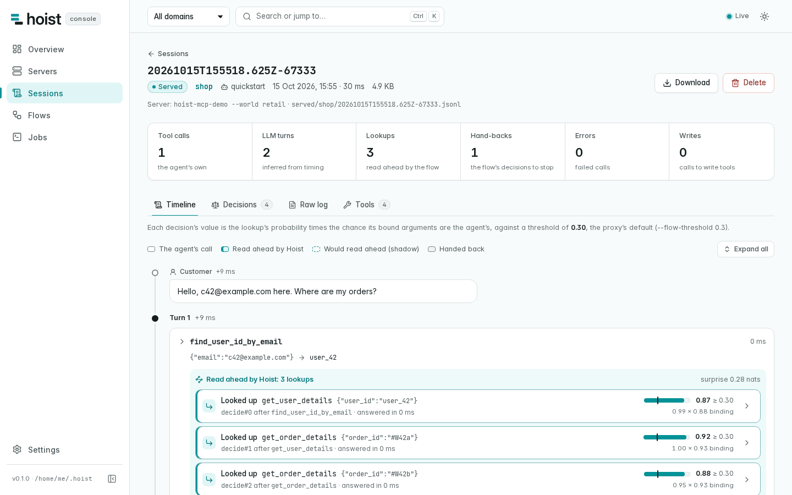

<p align="center">
  <a href="https://hoist.alexnodeland.com/">
    <picture>
      <source media="(prefers-color-scheme: dark)" srcset="brand/logo/hoist-lockup-dark.svg">
      
    </picture>
  </a>
</p>

<h3 align="center">Read ahead of your agent.</h3>

<p align="center">
  <a href="https://github.com/alexnodeland/hoist/actions/workflows/ci.yml"></a>
  <a href="https://hoist.alexnodeland.com/"></a>
  <a href="paper/hoist.md"></a>
  <a href="paper/latex/hoist.pdf"></a>
  <a href="https://doi.org/10.5281/zenodo.23403984"></a>
  <a href="LICENSE"></a>
</p>

<p align="center">
  <a href="#quick-start">Quick start</a> ·
  <a href="#how-it-works">How it works</a> ·
  <a href="#where-it-pays">Where it pays</a> ·
  <a href="#the-console">Console</a> ·
  <a href="https://hoist.alexnodeland.com/">Docs</a> ·
  <a href="#research">Research</a>
</p>

<p align="center">
  
</p>

Hoist learns, from your agent's recorded tool calls, which reads it makes next and where their arguments come from, and serves them through an MCP proxy in the same tool result, so the agent needs fewer LLM turns.

<p align="center">
  
</p>

<p align="center">
  
</p>

Also live: GLM-5.3 took 27.9% fewer LLM turns (95% CI 19.1–35.9%) in one run on the same tasks, and in AgentDojo's Slack and travel suites GLM-5.3 and Claude Haiku 4.5 took 10.1% fewer (5.8–14.0%), with passes unchanged (27 of 34 in both arms), one run per arm. The first row is 28 tasks, three trials. [The claims ledger](docs/results/claims.md) has each number with its scope.

## Quick start

```sh
# macOS or Linux: the release binaries, checked against the release's SHA256SUMS
curl -fsSL https://github.com/alexnodeland/hoist/releases/latest/download/install.sh | sh
# or Homebrew
brew install alexnodeland/tap/hoist
# or from source
cargo install --locked --git https://github.com/alexnodeland/hoist hoist-report hoist-mcp

hoist doctor
```

[Every way to install](docs/install.md). Then see the whole loop in about a second, with no key and no network: it records six sessions on a demo shop, learns, reviews and serves a flow.

```sh
curl -fsSLO https://raw.githubusercontent.com/alexnodeland/hoist/main/examples/quickstart/run.sh
sh run.sh
```

Then put your own server behind the proxy. `hoist init` prints the host's configuration and the steps from there:

```sh
hoist init --host claude-code --domain orders -- npx -y @your/mcp-server
# ...use your agent as usual: its sessions are recorded in ~/.hoist/logs/orders...
hoist learn --sessions ~/.hoist/logs/orders --domain orders --habit-only --out orders.flow.json
hoist flow-show orders.flow.json
hoist init --host claude-code --flow orders.flow.json --shadow -- npx -y @your/mcp-server
```

`--host` also takes `claude-desktop`, `cursor` and `vscode`. [The guide](https://hoist.alexnodeland.com/guide/) walks through each step, and [the walkthrough](docs/walkthrough.md) runs the loop on the official MCP filesystem server.

<details>
<summary><strong>When to relearn a flow</strong></summary>

<br>

A flow fits the agent, prompt, harness and tools it was learned from. `hoist drift --flow orders.flow.json --sessions ~/.hoist/logs/orders` scores the sessions a flow served, in the order they ran. It exits with 1 when the agent changed in the last few sessions, and names the sites that moved. Relearn then, with `learn --half-life` or `stage --half-life` so that the sessions since the change count most. On the server's side, the proxy stops making a lookup on its own once the server no longer lists the tool, marks it as a write, or changes its input, and the flow log says why.

</details>

## How it works

<p align="center">
  
</p>

- **Any MCP server.** `hoist-mcp` wraps a server run as a command or reached over Streamable HTTP. An agent framework that exports OpenTelemetry GenAI spans can learn from those instead ([OpenTelemetry spans](https://hoist.alexnodeland.com/integrations/opentelemetry)).
- **Reads only.** A flow calls only the tools the server does not mark as writes.
- **Reviewed before it serves.** In shadow mode a flow decides and logs but looks nothing up. `hoist promote` keeps the sites where its lookups were the agent's own. As sessions arrive, `hoist stage` learns the next version beside the served flow and scores the two, and `hoist flow-commit` serves it, keeping every version for `flow-rollback` ([staged flows](https://hoist.alexnodeland.com/guide/concepts/staged-flows)).
- **No user to speak?** `hoist-procedure` runs a whole workflow compiled once from traces, writes included. It hands back whatever its own check of the outcome cannot confirm.

## Where it pays

<p align="center">
  
</p>

The bars are ceilings, not savings. In τ²-bench retail, in replay, Hoist takes 86.4% of its ceiling. Where each request names what to read, the lever is language, not a pattern, and in WorkBench Hoist makes no lookup.

## The console

<p align="center">
  <picture>
    <source media="(prefers-color-scheme: dark)" srcset="brand/media/console/session-dark.png">
    
  </picture>
</p>

`hoist-console` is a web app on your machine, over the files Hoist writes to `~/.hoist`:

| | |
|---|---|
| **Servers** | the MCP servers Hoist fronts, the configuration to paste into each host, a live connection test |
| **Sessions** | every call, with the lookups the flow made after it and why |
| **Flows** | each flow's graph and review, and what would change at another threshold |
| **Jobs** | `learn`, `promote`, `audit`, `redact` and `doctor`, run from the page |

`make console` builds the UI and serves `~/.hoist` on 127.0.0.1:7878; open the URL it prints, which carries a token. [The console's guide](docs/console.md) covers the container, signing in, and each page.

## Documentation

| | |
|---|---|
| [Guide](https://hoist.alexnodeland.com/guide/) | What Hoist is and the quick start. The concepts: sessions, flows, lookups and detours, deciders, bindings, shadow mode, procedures |
| [Integrations](https://hoist.alexnodeland.com/integrations/) | Claude Code, Claude Desktop, Cursor and VS Code, and servers over Streamable HTTP |
| [The console](docs/console.md) | The web app over `~/.hoist`: running it, signing in, and each page |
| [CLI reference](docs/cli.md) | Every command and option, generated from the code |
| [File formats](docs/formats.md) | The flow IR, arbiters, procedures and session logs, field by field |
| [Privacy](docs/privacy.md) | What each file keeps, what is sent where, and `hoist redact` |
| [Research](https://hoist.alexnodeland.com/research/) | The paper, every results page, and how to reproduce each number |

## Research

Hoist is also a research project. The paper, [*Compile What the Environment Decides*](paper/hoist.md) ([PDF](paper/latex/hoist.pdf)), states the model and asks three questions:
- which of an agent's decisions a program learned from traces can take over;
- why a read-only speculator should decide on the chance of use before the next write, at a threshold set by costs;
- what a procedure compiled once does where no user speaks.

<details>
<summary><strong>Every headline result, with its scope</strong></summary>

| Evidence | Result |
|---|---|
| Live, Claude Sonnet 5 and Claude Haiku 4.5, 28 τ²-bench retail and airline tasks, three trials, pre-registered | 20.5% (95% CI 16.5–24.4%) and 22.4% (15.8–29.4%) fewer LLM turns; passes 65 → 69 and 58 → 62 of 84; a prompt for parallel tool calls saved 3.4% and 5.9%; with it in both arms, the flow still saved 22.9% and 17.2% |
| Live, GLM-5.3, 28 τ²-bench retail and airline tasks | 27.9% fewer LLM turns (95% CI 19.1–35.9%); 21 passed, against 24 |
| Live, GLM-5.3 and Claude Haiku 4.5, AgentDojo's Slack and travel suites | 10.1% fewer LLM turns (5.8–14.0%); 27 of 34 passed in both arms |
| Live, `glm-5.3-flash` served a speculator learned from three frontier models' traces, with the policy guards, 20 τ²-bench retail and airline tasks | 20.8% fewer LLM turns (95% CI 11.0–29.9%); 18 of 20 passed in both arms; the guards refused one write |
| Replay, nine agents it never saw, τ²-bench retail | 86.4% of the read-only ceiling, 10.2 points more than a next-step speculator |
| Published trajectories of 89 more agents, six benchmarks | the ceiling runs from 3.5% of turns (WorkBench) to 47.1% (AgentDojo travel) |
| A procedure compiled once, τ²-bench solo telecom | 39 of 40 held-out tasks, at 0.48 LLM turns per ticket against 15.9 |
| The same procedure, on 2,171 telecom tickets no trace showed | 84.3% with no model; with Claude Haiku 4.5 on its hand-backs, 99.0% projected at 0.80 LLM turns per ticket, where Haiku alone passed 8 of 20 |

</details>

- **The claims ledger.** [docs/results/claims.md](docs/results/claims.md) maps each headline number to its evidence: live, replayed against an environment, or counted from published trajectories. It also lists what the evidence does not show.
- **Every round.** [docs/results](docs/results/README.md) has each round with its rows and its episodes.
- **The design.** It is [RFC-001](docs/rfc/001-habit-compiler.md).

## Status

Hoist is pre-1.0.
- Every piece of the first design is built, tested and measured ([implementation status](docs/design.md#implementation-status-2026-09-26)).
- 0.2.0 is the first release ([changelog](CHANGELOG.md)). The file formats carry their own versions.
- No release is on crates.io yet, because Hoist depends on a [fugue](https://github.com/alexnodeland/fugue) feature that is not released. The `hoist-*` crates exist there only as empty 0.0.0 placeholders that hold their names.
- What is left is on [the roadmap](docs/roadmap.md).

## Crates

<details>
<summary><strong>What each crate holds</strong></summary>


| Crate | What it holds |
|---|---|
| `hoist-mcp` | `hoist-mcp`, the MCP proxy: it records sessions and serves flows, guards and the confirmation judge ([README](crates/hoist-mcp/README.md)). Also `hoist-procedure`, the procedure runtime, and `hoist-mcp-demo`, the demo server |
| `hoist-report` | `hoist`, the CLI: `init`, `doctor`, `learn`, `stage`, `flow-show`, `flow-diff`, `flow-commit`, `promote`, `audit`, `redact`, and the research commands |
| `hoist-console` | `hoist-console`, the console: an HTTP API over `~/.hoist`, and the web app in `console/`, built into the binary ([README](crates/hoist-console/README.md)) |
| `hoist-model` | The habit (a hierarchical Dirichlet back-off model), argument provenance and bindings, policy checks |
| `hoist-trace` | The episode schema, and ingest of τ²-bench results, the proxy's session logs and OpenTelemetry GenAI spans |
| `hoist-oracle` | The System-One client (TypeSafe's Jev), with an on-disk replay cache |

</details>

## Contributing

Issues and pull requests are welcome.
- [CONTRIBUTING.md](CONTRIBUTING.md) has the setup, the checks CI runs, and the rules for results and claims.
- Report security issues privately ([SECURITY.md](SECURITY.md)).
- Everyone taking part follows the [code of conduct](CODE_OF_CONDUCT.md).

## Citing

If you use Hoist or its results, please cite the paper ([PDF](paper/latex/hoist.pdf), [CITATION.cff](CITATION.cff)):

```bibtex
@misc{nodeland2026compile,
  title  = {Compile What the Environment Decides: Read-Only Speculation and Compiled Procedures for LLM Agents},
  author = {Nodeland, Alex},
  year   = {2026},
  note   = {Preprint},
  doi    = {10.5281/zenodo.23403984},
  url    = {https://github.com/alexnodeland/hoist}
}
```

## License

The code is [MIT](LICENSE). The paper (`paper/`) is [CC BY 4.0](https://creativecommons.org/licenses/by/4.0/).
